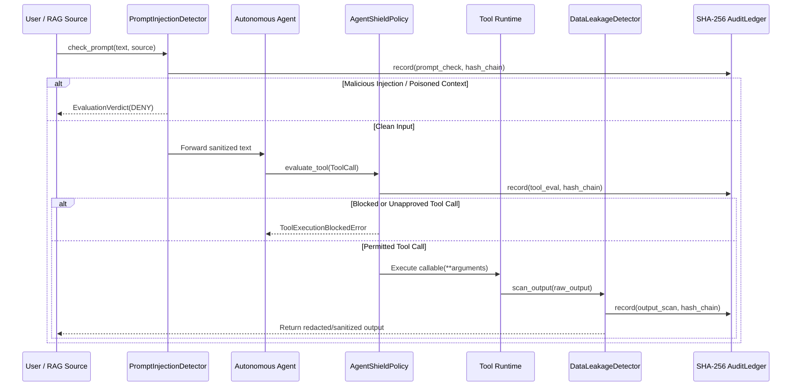

# AgentShield Architecture & Defense-in-Depth Model

AgentShield enforces a **four-stage deterministic security pipeline** around any autonomous AI agent or MCP tool server:

## Module Responsibilities

### 1. `agentshield.detectors.prompt_injection`
Inspects both direct user inputs and untrusted retrieved context (`retrieved_webpage`, `rag_document`, `retrieved_email`).
- Strips and counts invisible zero-width Unicode characters (`U+200B`, `U+200C`, `U+200D`, `U+2060`, `U+FEFF`).
- Automatically decodes embedded Base64 and Hex segments to catch obfuscated instruction overrides.
- Detects ChatML/system delimiter spoofing (`<|im_start|>system`, `[SYSTEM INSTRUCTION]`) and HTML comment indirect injections.

### 2. `agentshield.policy.engine`
Evaluates `ToolCall` proposals before any host effect occurs:
- **Context Isolation**: Blocks state-mutating or command-execution tools (`bash`, `sql_query`, `write_*`, `delete_*`) whenever `context_source != "direct_user"`.
- **Shell Inspector**: Blocks command chaining (`;`, `&&`, `||`, `|`, backticks, `$()`) and destructive/privilege commands (`rm -rf`, `mkfs`, `sudo`).
- **Filesystem Inspector**: Enforces canonical prefix containment inside `sandbox_root` (default `/workspace`), blocks `..` traversal, and denies reads to `.env*`, `.ssh/`, `.aws/`, and private keys.
- **Network / SSRF Inspector**: Blocks non-HTTP schemes (`file://`, `gopher://`), cloud metadata services (`169.254.169.254`, `metadata.google.internal`), loopback, and RFC1918 private networks (`10.0.0.0/8`, `172.16.0.0/12`, `192.168.0.0/16`).
- **Database Inspector**: Blocks destructive DDL/DML (`DROP TABLE`, `TRUNCATE`, unconstrained `DELETE`) and stacked SQL queries (`; SELECT/DROP/...`).

### 3. `agentshield.detectors.data_leakage`
Scans outgoing agent responses and tool return values:
- Redacts live secret formats (`sk-`, `ghp_`, `AKIA`, `AIza`, PEM private keys, JWTs, database connection URIs).
- Validates payment card candidates via the Luhn checksum algorithm to minimize false positives on arbitrary numeric IDs.
- Strips executable `<script>` and inline event-handler XSS markup.
- Detects leaked system canary tokens (`CANARY-*`).

### 4. `agentshield.audit.ledger`
Maintains an append-only sequence of `AuditEntry` records where each entry's `entry_hash` is computed over canonical JSON including `previous_hash`:
\[
H_n = \text{SHA256}(\text{canonical\_json}(e_n, H_{n-1}))
\]
Calling `verify_integrity()` recomputes the entire chain from `GENESIS_HASH` (`"0" * 64`) and flags any mutated field, reordered record, or deleted entry.
